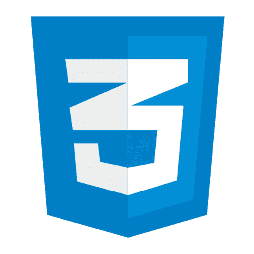
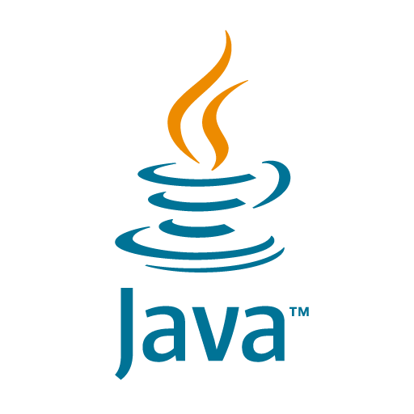
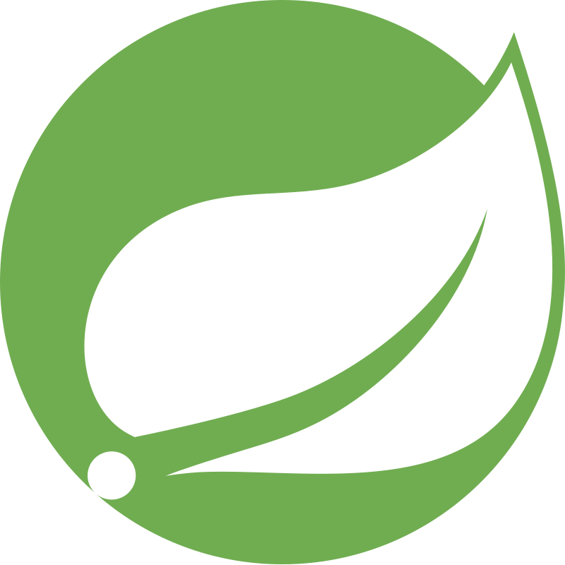
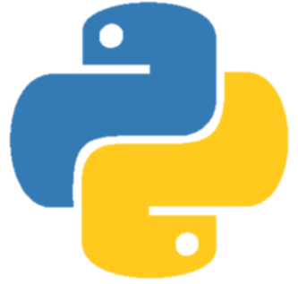
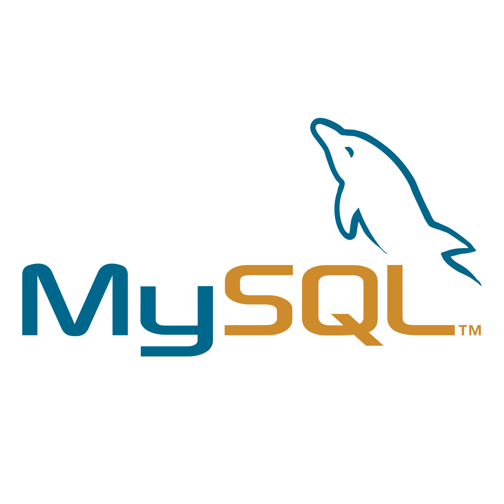
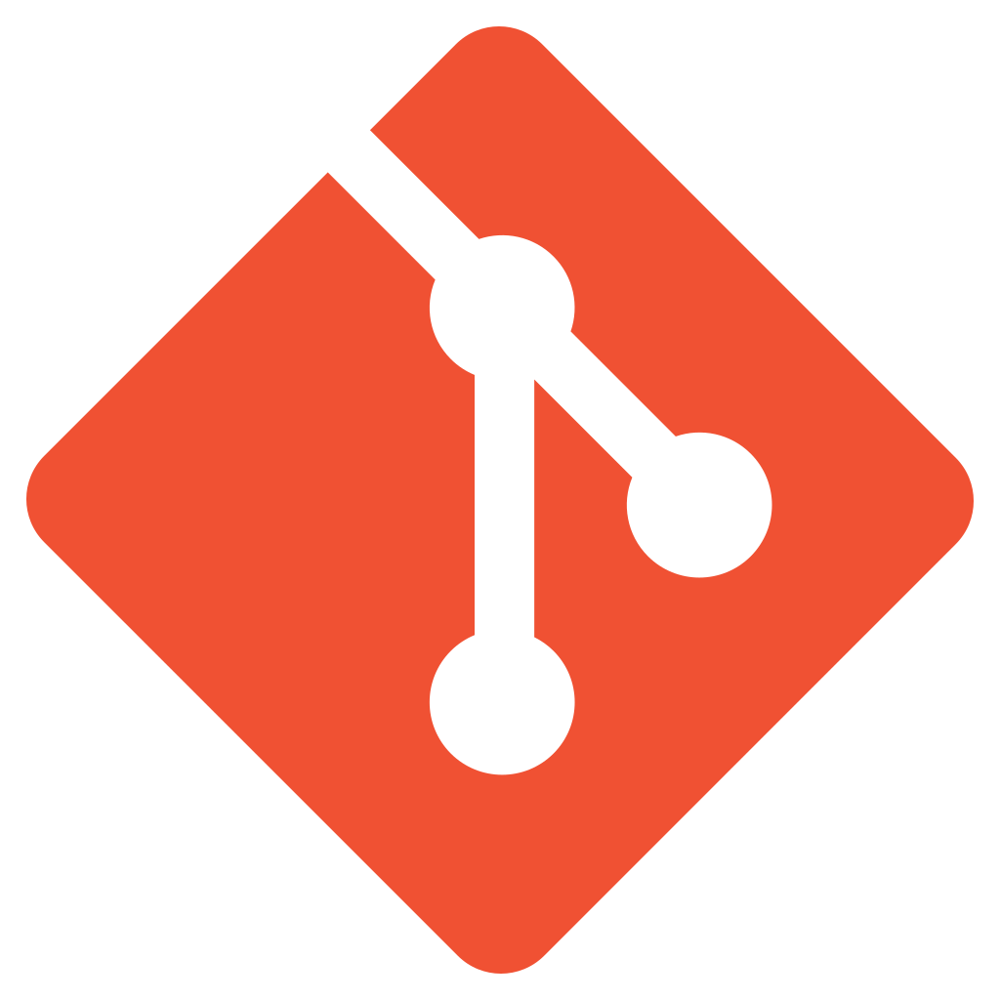
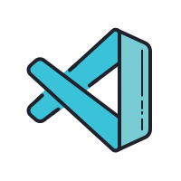

<h1 align="center"> Hello developers, I am Cristian Aguirre 👋 </h1>

Java Programmer | Web Developer | Data Engineer | "Book lover" | Emprendedor 

# 💫Sobre mi :
- :seedling: Formacion como Java Developer y Data Engineer.
- :handshake: Sin problema alguno, me encanta colabrar en proyectos y seguir aprendiendo.
- :v: Estoy dispuesto a escuchar nuevas ofertas.
- :zap: Con mucho esfuerzo y sacrificio, abrí una libreria de la cual estoy muy orgulloso.

# Mis Redes

 

<h2 align="center" id = "work-experience">🚀 Mi Experiencia Profesional </h2> 

<table>
  <thead align="center">
    <tr border: none;>
      <td><b> 💼 Puesto </b></td> 
      <td><b> 🏢 Organización </b></td> 
      <td><b> ⏰ Tiempo  </b></td> 
      </tr>
  </thead>
  <tbody> 
    <tr>
      <td> <b> Administrador de Sitemas </b> </td>
      <td> <b> Clinica Medica Privada </b> </td>
      <td> <b> Enero 2024 - Diciembre 2025 </b> </td>
   </tr>
   <tr>
      <td> <b> Desarrollador Back-end </b> </td>
      <td> <b> No Country </b> </td>
      <td> <b> Septiembre 2022 - Junio 2023 </b> </td>
   </tr>
   <tr>
      <td> <b> Java Developer </b> </td>
      <td> <b> Alkemy </b> </td>
      <td> <b> Junio 2022 - Agosto 2022 </b> </td>
   </tr>
   </tbody>	 
</table>

  

<h3 align="center"> 💼 Algunos Lenguajes y Herramientas </h3>

#

&nbsp;&nbsp;&nbsp;&nbsp;&nbsp;&nbsp;&nbsp;&nbsp;&nbsp;

 
